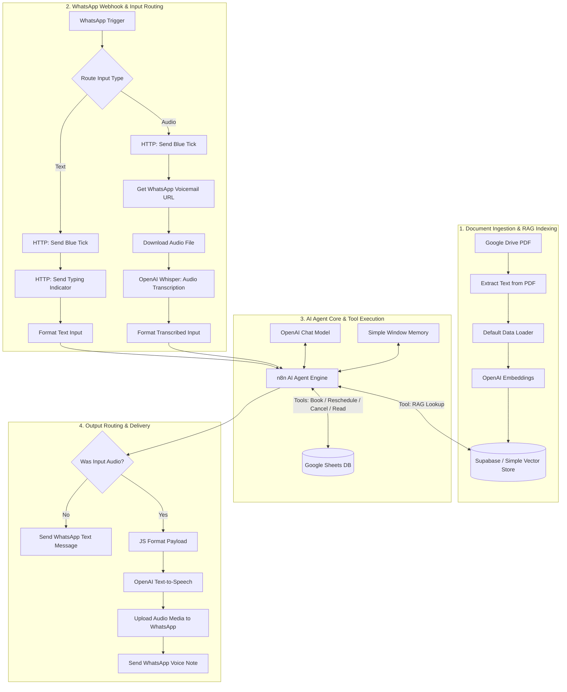

# 🤖 Autonomous WhatsApp AI Appointment & FAQ Agent (n8n)

A production-ready, multimodal AI agent built with **n8n**, **OpenAI**, **Supabase**, and **Google Sheets**. It seamlessly handles inbound text and voice messages over WhatsApp, manages real-time appointments, and answers domain-specific FAQs using Retrieval-Augmented Generation (RAG).

---

## 📐 Architecture & Workflow Graph



---

## ✨ Key Features

- **🎙️ Multimodal Support (Voice & Text)**: Autodetects input type. Converts incoming voice notes to text via OpenAI Whisper, and generates voice note responses using OpenAI TTS.
- **📅 Complete Appointment Lifecycle**:
  - Check doctor availability & timings
  - Book new appointments
  - Reschedule existing appointments
  - Cancel appointments
  - Fetch user appointment history
- **🧠 Knowledge Base (RAG)**: Automatically processes PDFs from Google Drive, stores embeddings in Supabase/Vector Store, and answers queries regarding pricing, location, and procedures.
- **⚡ Native UX Feedback**: Triggers real-time WhatsApp blue ticks (read receipts) and typing indicators immediately upon message receipt.

---

## 🛠️ Required n8n Credentials & Services

To run this workflow, configure the following credential connections in your n8n instance:

1. **Meta WhatsApp Cloud API**: API Access Token & Phone Number ID for webhooks, blue ticks, and media uploads.
2. **OpenAI API Key**: Used for Chat Model (GPT-4o), Whisper (Speech-to-Text), TTS (Text-to-Speech), and Embeddings (`text-embedding-3-small`).
3. **Google Sheets OAuth2 / Service Account**: Read/Write access to the Appointment spreadsheet.
4. **Google Drive OAuth2 / Service Account**: Read access for document vectorization.
5. **Supabase / Vector Store**: Storage for vector embeddings.

---

## 🚀 Quick Start / Import Instructions

1. **Clone the Repository**:
   ```bash
   git clone https://github.com/YOUR_USERNAME/whatsapp-appointment-agent.git
   cd whatsapp-appointment-agent
   ```
2. **Environment Configuration**:
   Copy `.env.example` to `.env` and populate your keys:
   ```bash
   cp .env.example .env
   ```
3. **Import into n8n**:
   - Open your n8n dashboard.
   - Click **Workflows** -> **Import from File**.
   - Select `whatsapp-appointment-agent.json`.
4. **Configure Nodes & Credentials**:
   - Attach your credential setups to the OpenAI, Meta, Google Sheets, and Supabase nodes.
   - Set up your Meta WhatsApp Webhook pointing to your n8n instance URL.
