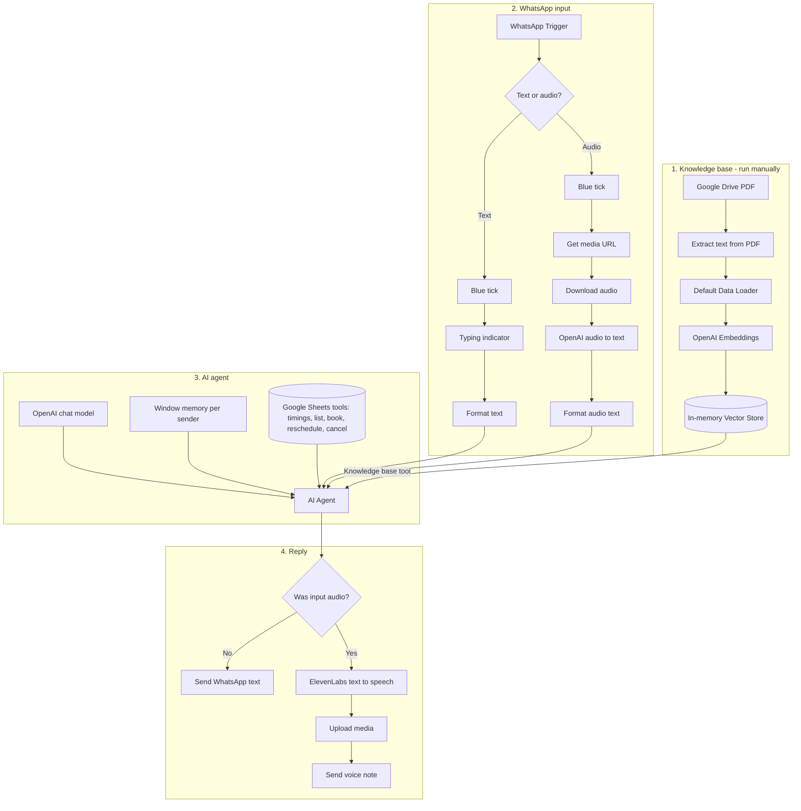

# WhatsApp AI Appointment & FAQ Agent (n8n)

An n8n workflow that lets patients or customers book, reschedule and cancel appointments over WhatsApp, by text or voice note, and answers questions from a PDF knowledge base.

This is a simple reference build that shows the architecture. It is not a hardened production system: it has no retry settings, no error workflow and no fallback reply if a step fails.

## How it works

## Features

- Text and voice-note input. Voice notes are converted to text with OpenAI. Voice replies are generated with ElevenLabs.
- Appointment lifecycle through Google Sheets: check doctor timings, list appointments, book, reschedule and cancel.
- Slot availability is calculated from a timings sheet (day, start and end time, slot length, max patients per slot).
- FAQ answers from a PDF, using OpenAI embeddings and an in-memory vector store. The store is lost when n8n restarts, so re-run the manual ingestion branch after a restart or swap in a persistent store.
- WhatsApp read receipts and typing indicator on every incoming message.

## Credentials and setup

Nothing is configured in the exported file. After importing, set these up in n8n and attach them to the nodes:

1. **WhatsApp** (Meta Cloud API): access token and phone number ID, for the trigger, send and upload nodes.
2. **OpenAI**: chat model, audio, embeddings.
3. **ElevenLabs**: text to speech. Pick a voice in the node.
4. **Google Sheets OAuth2**: an appointments sheet and a doctor-timings sheet. The prompt expects these columns:
   - Appointments: `Appointment_id, Patient_Name, Phone, Doctor_Name, Date, Slot_Time, Status, Reason, Confirmed`
   - Timings: `Doctor_name, Day, Start_time, End_time, Slot Duration, Max_Patient_Per_Slot, Active`
5. **Google Drive OAuth2**: to read the knowledge-base PDF.

The three HTTP Request nodes that send the blue tick and typing indicator contain `YOUR_PHONE_NUMBER_ID` and `YOUR_WHATSAPP_ACCESS_TOKEN` placeholders. Replace them, or move them to a credential.

## Import

1. In n8n, go to **Workflows → Import from file** and choose `Whatsapp Appointment Agent.json`.
2. Select the Sheets, Drive and phone number ID in each tool node, and attach credentials.
3. Run the manual trigger once to load the PDF into the vector store.
4. Point the Meta WhatsApp webhook at the WhatsApp Trigger's production URL and activate the workflow.

## License

See `LICENSE`.
